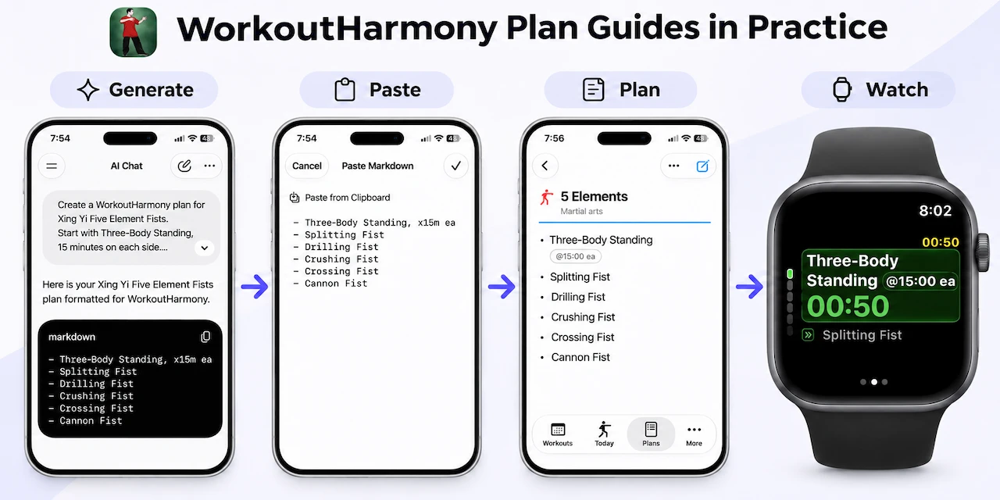

# WorkoutHarmony — Workout Plan Guides & AI Skills

## About WorkoutHarmony

**WorkoutHarmony** is a flexible workout planning and tracking app designed for iPhone, with optional Apple Watch and Mac support.

WorkoutHarmony is currently used internally. The workout plan guides are publicly available.

The app is built around the idea that workouts should adapt to individual training needs, rather than forcing users into predefined exercises or rigid structures.



WorkoutHarmony supports a wide range of training scenarios, including:

- **Strength training:** Traditional exercises, variable sets, circuits, supersets, and changing repetitions or weights.
- **Martial arts and movement practice:** Structured routines combining timed practice, repeated movements, and different training sections.
- **Physical therapy and rehabilitation:** Support asymmetric training with different repetitions or weights for the left and right sides of an exercise, or separate side-specific steps for different movements.
- **Alternating workout plans:** Maintain multiple training plans for the same activity, such as heavy and light versions, and alternate between them according to training needs.
- **Mixed and personalized workouts:** Combine different exercises, timers, repetitions, and training methods within a single workout.

### Device Flexibility

- **iPhone:** The primary app for creating, performing, tracking, and reviewing workouts. It works independently without an Apple Watch.
- **Apple Watch (optional):** Enhances workouts with wrist-based controls, timers, and heart rate recording. Heart rate can be reviewed for individual exercise steps when samples are available.
- **Mac (optional):** Provides additional convenience for creating, editing, and managing workout plans.

### Key Capabilities

- **Flexible workout structures:** Organize exercises into sections, rounds, combined steps, and variable sets. Support progressive weights and repetitions across sets, as well as rounds with varying exercises, workloads, durations, and rest intervals.
- **Guided workouts:** Follow structured training sessions with repetitions, weights, timers, and other exercise properties.
- **Off-wrist workouts:** Take off the Watch for exercises where equipment could hit it, such as kettlebell work, then put it back on and continue. You can also run the workout on iPhone and play voice prompts through its speaker so a group can follow along.
- **Workout history and analysis:** Review completed workouts, including exercise-level heart rate records when Apple Watch samples are available.
- **Personal customization:** Adjust exercises, workloads, and workout structures to accommodate different training methods and individual needs.
- **Markdown-based plans:** Create and modify structured workouts using a readable format, including plans generated with AI assistance.
- **AI-assisted plan editing:** Use Copy Markdown to export a workout plan's sections and steps, revise them using your preferred AI chat or agent, then paste the complete updated Markdown back into the app for review and saving.

## About This Repository

This repository provides the **WorkoutHarmony Markdown workout format**, along with open guides and AI authoring skills for creating, modifying, and maintaining workout plans.

The format is designed to be human-readable while supporting the flexible workout structures used by WorkoutHarmony.

With your preferred AI chat or coding agent, you can:

- Create structured workout plans from natural-language descriptions.
- Modify existing plans while preserving unrelated exercise steps and properties.
- Customize exercises, repetitions, weights, durations, rounds, and flexible steps.
- Maintain reusable workout plans as Markdown files.

**You do not need WorkoutHarmony, an AI API key, or access to the app's source code to use these guides.**

The goal is to share practical, reusable tools that people can adapt to their own training needs and workflows.

## Getting Started

Choose one of the following approaches to create or update a workout plan.

### Simple Chat Guide

[chat.md](chat.md)

A self-contained guide that can be pasted or attached to an ordinary AI chat.

It covers sections, simple and combined steps, rounds with flexible steps, left/right rules, and supported step properties.

No skill installation is required.

### Advanced Plan Skill

[workout-harmony-plans/SKILL.md](workout-harmony-plans/SKILL.md)

An agent skill for more advanced workout plan authoring, including detailed round and flexible-step syntax.

Keep the skill folder and its reference files together when sharing or installing it in a compatible AI agent.

### Worked Examples

[examples.md](examples.md)

Includes sample prompts and complete Markdown examples for creating workout plans and revising them with either guide.

For help choosing steps, timers, and cues, see the [Workout Design Tips](workout-design-tips.md).

## Creating and Updating Workout Plans

1. Describe the workout you want to create, including exercises, repetitions, weights, durations, and any special structure.
2. Use the simple chat guide or advanced skill to generate the workout Markdown.
3. Review the generated Markdown as a readable workout plan and save it for future use.
4. To modify the workout, provide the existing Markdown and describe the changes you want.

Each request produces the complete contents of one workout. When updating an existing workout, the AI should preserve unrelated exercise steps and properties.

Advanced users can maintain individual workouts as named Markdown files for future revisions.

### Using Plans in WorkoutHarmony

Once you have access to WorkoutHarmony:

1. Create or select a workout plan in the app.
2. Set the plan details and paste the generated Markdown into the editor.
3. Review the workout structure and save the plan.
4. Make small exercise-name or property adjustments directly in the iPhone editor when needed.

### Updating Existing Plans with AI

WorkoutHarmony supports a simple round-trip workflow for updating existing workout plans:

1. Use **Copy Markdown** in WorkoutHarmony to copy the plan's sections and steps.
2. Provide the Markdown to your preferred AI chat or agent, along with the changes you want.
3. Paste the complete revised Markdown back into WorkoutHarmony, review the changes, and save the plan.

The guides instruct the AI to preserve unrelated exercises and properties, allowing complex workout plans to be revised without manually editing individual exercises.

No direct AI integration or API key is required.

## Markdown Format Example

WorkoutHarmony supports more than simple exercise lists. Its Markdown format can describe variable sets, timed exercises, combined steps, and repeated rounds.

For example:

```markdown
##### Strength
- Row, x10@10|x8@15|x6@20

##### Mobility
- Shoulder circles, x30s
```

This example contains:

- **Variable Sets:** Row uses three sets with different repetitions and weights. In the app, the exercise is completed with one Next action after all three sets.
- **Timed Exercise:** Shoulder circles uses a 30-second timer.
- **Sections:** Strength and Mobility organize the exercises into separate parts of the workout.

The same format supports ordinary steps, combined exercises, and repeated rounds. Flexible round slots can vary both exercise selection and workload across sets.

The values above illustrate the Markdown format rather than prescribe a training program.

For complete syntax and supported properties, see the [Markdown format reference](workout-harmony-plans/references/markdown.md).

## Customization and Extensibility

The guides and skill are intended as starting points for personal workout planning and AI-assisted authoring.

You can copy, adapt, or extend the guides and skill to match your own training needs and workflows. You can also ask a coach, physical therapist, or friend to help customize them for you.

For example, you may provide additional rules for:

- Exercise selection and ordering.
- Repetitions, weights, rest periods, and timing.
- Strength training or physical therapy routines.
- Adjusting plans based on previous workout results.

For more complex training structures:

- **Variable Sets** allow repetitions or weights to change within an individual exercise.
- **Flexible round steps** allow repetitions, weights, hold durations, or exercise selections to vary between repetitions of a round.

To revise a plan based on completed workouts, provide the results you want the AI to consider.

### Keep Training Rules Separate from Format Rules

Personal training preferences and plan-generation rules should remain separate from the [Markdown format reference](workout-harmony-plans/references/markdown.md).

You can customize how a workout is designed, but the generated Markdown must still follow structures and properties supported by WorkoutHarmony.

If you extend the guides or skill, clearly describe the additional inputs, rules, and expected behavior so others can understand and adapt your changes.

These tools assist with workout-plan authoring; they do not prescribe a particular training program.

## Feedback and Collaboration

Suggestions, examples, and documentation improvements for the guides and authoring skill are welcome in this repository's issues.

**Simplicity is a core design principle.** Improvements should address real workout needs while keeping the app, Markdown format, and authoring tools straightforward and easy to use. Additional complexity should be justified by clear practical value.

## License and Attribution

The guides, skill, examples, and reference files in this repository are provided under the [MIT License](LICENSE).

They may be reused, modified, and distributed, including for commercial applications, subject to the license terms.

**Original WorkoutHarmony Markdown format design:** George ([commanders.ca](https://commanders.ca)).

The format definitions and examples document the original design and its terminology. Contributors may be credited for their own additions alongside the original designer.

Copies or substantial portions of the licensed files, including modified versions, must retain the required copyright and MIT license notice.

**The MIT license for this repository does not cover the WorkoutHarmony application itself.**

Optional attribution when implementing the format:

> Workout Markdown format based on the original 2026 design by George (commanders.ca).
